# Logic Design Sim

[](https://github.com/AmirrezaAminrad/logic-design-sim/actions/workflows/ci.yml) [](LICENSE)

**[Live demo →](https://amirrezaaminrad.github.io/logic-design-sim/)**

An interactive digital-logic circuit designer and simulator that runs entirely in the browser — from a single AND gate up to a toy CPU that executes assembly. It is both a teaching tool (hover any component for an explanation) and a working design tool (buses, custom ICs, timing analysis). Responsive and touch-friendly: docked panels on a desktop; slide-over drawers, a bottom bar and pinch-zoom on a tablet or phone.

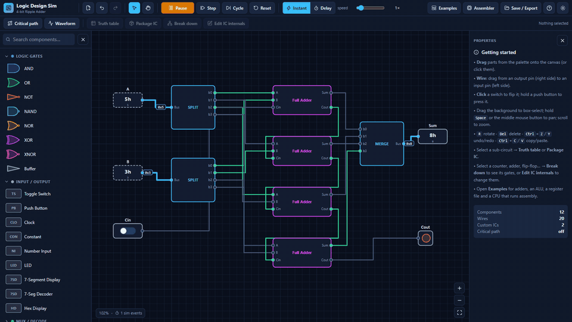

*The 4-bit ripple-carry adder: change the number inputs and the sum updates instantly; the critical-path overlay then highlights the longest route through the carry chain and estimates the max clock from the parts' transport delays.*

## Contents

[Quick start](#quick-start) · [Feature tour](#feature-tour) · [The toy CPU](#the-toy-cpu) · [Controls](#keyboard--mouse) · [Phones & tablets](#phones--tablets) · [Semantics](#component-semantics-worth-knowing) · [Project layout](#project-layout) · [Testing](#testing)

## Quick start

**Windows:** double-click **`start.bat`**. It checks for Node.js, installs dependencies on first run, starts the dev server and opens the app in your browser. Close the console window to stop.

Manual (any OS, Node.js 20.19+):

```bash
npm install
npm run dev -- --open   # → http://localhost:5173
```

| Script | What it does |
|---|---|
| `npm run typecheck` | TypeScript check (`tsc --noEmit`) |
| `npm test` | vitest suite over the simulation core and the IC / editing logic (561 tests) |
| `npm run build` | production build → `dist/index.html`, a single self-contained file |
| `npm run preview` | serve the production build |

`dist/index.html` can be opened directly or dropped on any static host. There is no backend; everything runs client-side.

## Feature tour

### Basics

- **Gates** AND, OR, NOT, NAND, NOR, XOR, XNOR, Buffer — 2–8 inputs and 1–16 bit widths via the properties panel.
- **I/O**: toggle switches, momentary push buttons, LEDs (4 colors), 7-segment display (+ built-in hex decoder), hex displays, constants and multi-bit number inputs.
- **Live simulation**: wires change color with their value — gray = 0, green = 1, thick blue = multi-bit bus with a hex value badge.
- An infinite pannable/zoomable canvas with snap-to-grid and orthogonal elbow routing.

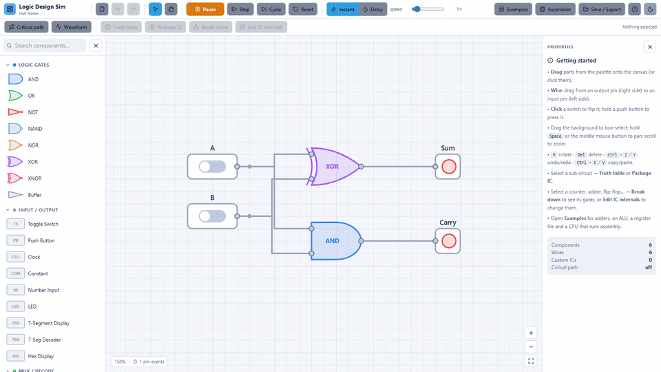

*A half adder in light mode. Flipping a switch turns the wires green as the signal propagates; the Sum and Carry LEDs follow.*

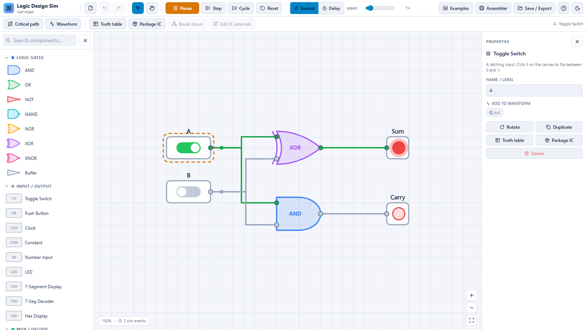

### Combinational logic

- Multiplexers and demultiplexers (2:1 / 4:1 / 8:1), decoders, encoders, **priority encoders** (with valid output).
- Half adder, full adder, **n-bit ripple-carry adder** (configurable width), unsigned comparator, an 8-op ALU with Z/C flags.
- **Buses**: any pin can be 1–16 bits; splitter / merger / slice components move bits between buses and single wires.
- **Truth table**: select any sub-circuit → `Truth table` exhaustively simulates it (up to 12 input bits / 4096 rows), shows minimized SOP expressions and Karnaugh maps for each output bit, and lets you click any row to drive the real circuit with those inputs. Sequential selections default to resetting state between rows (untick to simulate rows in order, like a test sequence). Export CSV or copy the table to the clipboard.

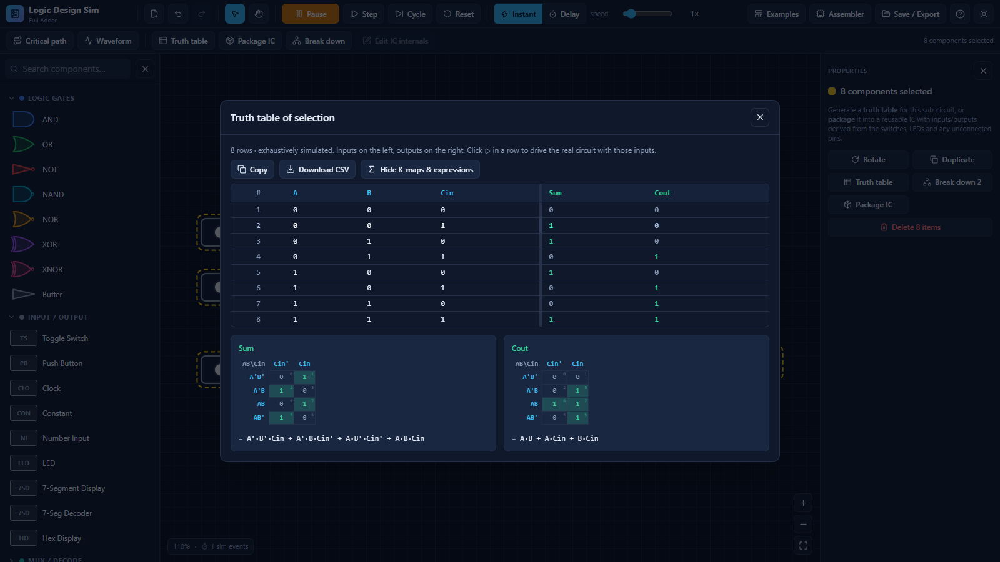

*The truth table of a selected full adder — exhaustively simulated, with Quine–McCluskey-minimized SOP expressions and gray-code Karnaugh maps for each output bit.*

### Sequential logic

- SR latch, D latch, D / JK / T flip-flops (async clear), n-bit registers with enable.
- **Clock** with adjustable frequency (instant mode) or period in ticks (delay mode), plus manual **Step / Cycle / Reset**.
- Up/down **binary and BCD counters** with load and terminal-count output, shift registers (left/right with serial-out).
- **Waveform viewer**: probe any pin from the properties panel (or "Add all I/O") and watch signals over time.
- **Propagation-delay mode**: every component has a transport delay (NOT 1 ns, AND/OR 2 ns, XOR 3 ns, n-bit adder 2+2n ns…), so glitches, races and ripple-carry settling are visible sample by sample.

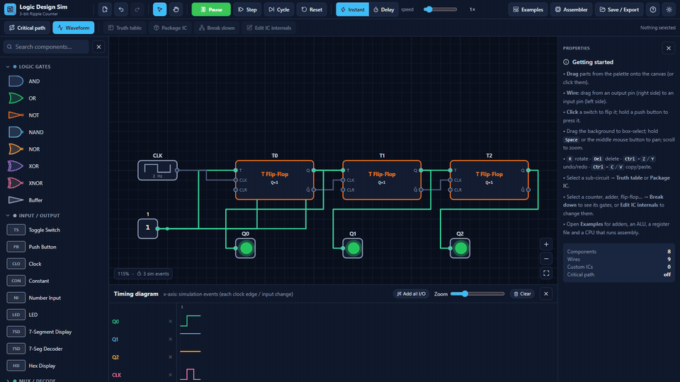

*A 3-bit ripple counter with the waveform viewer: Q0 toggles every clock edge, Q1 half as often, Q2 a quarter — the classic frequency-divider staircase.*

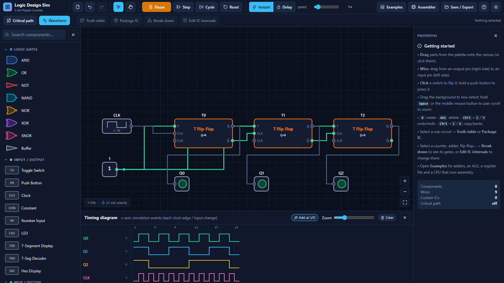

The **Digital Clock / Stopwatch** example cascades four BCD digit ICs into an MM:SS clock on 7-segment displays (RUN pauses it, hold RESET to zero it).

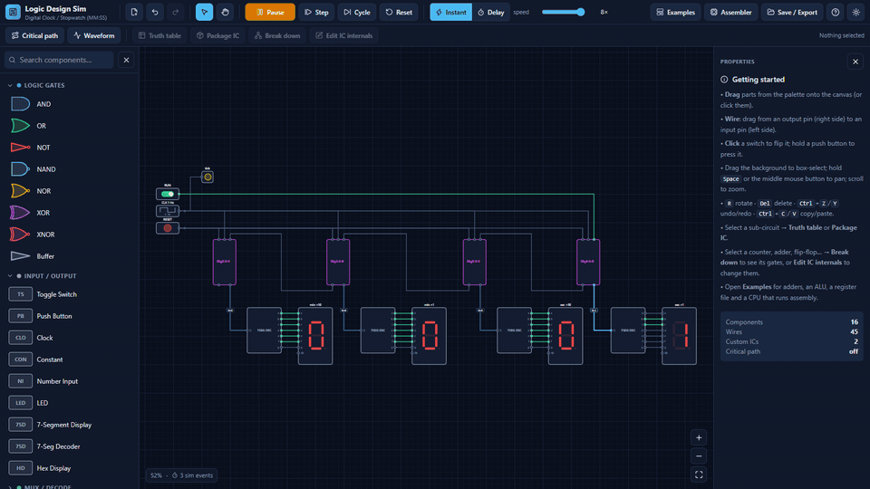

*The MM:SS clock fast-forwarded at 8× speed; each digit is a custom IC with its own carry logic.*

### Custom ICs, break-down and critical path

- **Custom ICs**: select components → `Package IC`. Switches/buttons/number inputs become input pins, LEDs/hex displays become outputs, unconnected pins are picked up automatically. Select an IC and press `Edit IC internals` (or double-click it) to edit its definition — every instance updates. ICs nest (full adder from two half adders, 4-bit adder from four full adders, …).
- **Break down**: select a complex component — mux, decoder, encoders, adders, comparator, ALU, any latch / flip-flop, register, counter, shift register, 7-seg decoder — or any custom IC, and press `Break down` (or `B`). The component is **deleted and its internals are put out on the canvas**, wired straight into the surrounding circuit; the new parts come out selected so you can drag the block aside. One level per click (adder → full adders, register → flip-flops, D-FF → master/slave latches → NAND gates; a custom IC is inlined exactly as defined). Probes follow the signal they were watching, unconnected inputs keep their defaults, and every expansion is verified equivalent to the original by exhaustive / sampled simulation tests. The 7-seg decoder's gate circuit is auto-minimized from its own truth table with Quine–McCluskey. Memory (ROM/RAM/register file) and I/O parts are already primitive and can't be broken down.
- **Edit IC internals**: on a custom IC it opens the definition; on a built-in complex part it first **turns the part into a custom IC** — same pins, position and wiring, with the gate-level circuit as its definition, listed in the palette under Custom ICs — and opens that for editing. Editors nest (open a flip-flop inside a counter inside…); *Done* steps out one level, and everything done in an editor is a single undo step for the level above.
- **Critical path** analysis: the longest register-to-register / input-to-output path via each part's delay, highlighted on the canvas with a max-clock estimate.

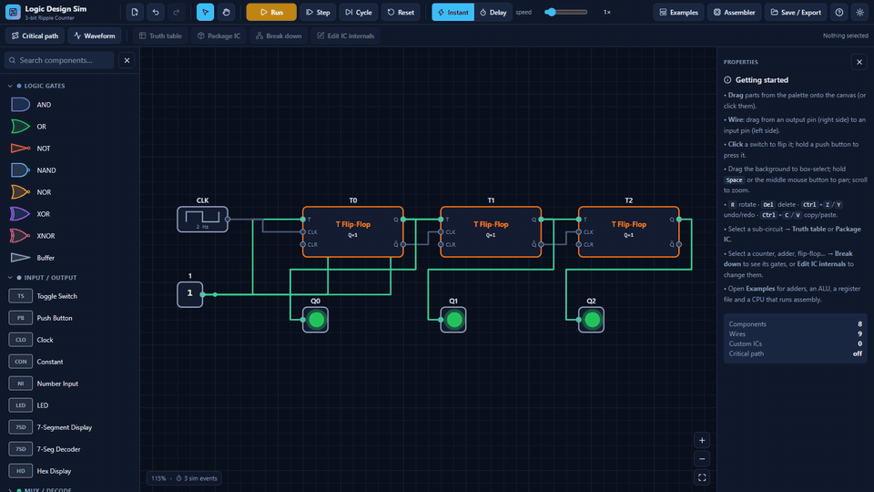

*`Break down` on a T flip-flop: the part disappears and its gate-level internals appear in its place, still wired into the counter.*

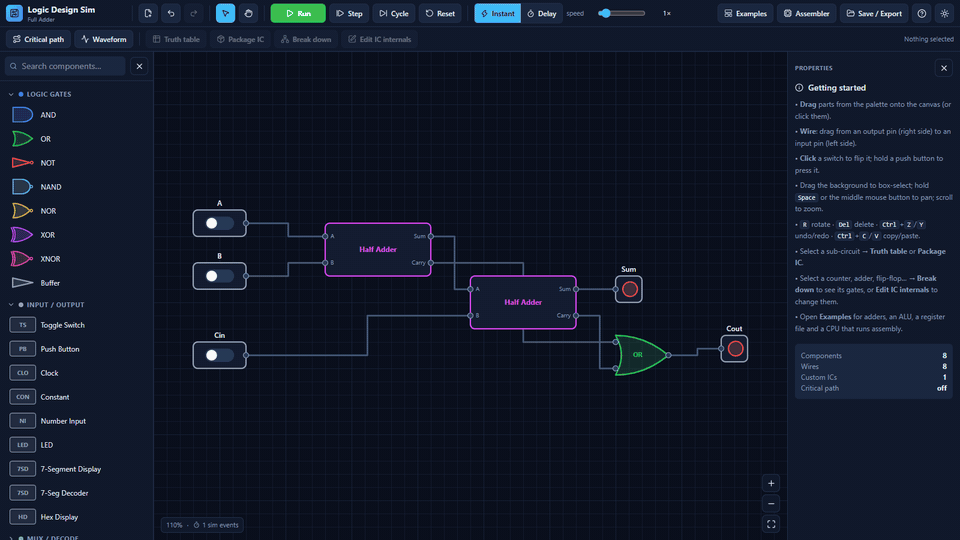

*Editing a custom IC: select it, open its internals (a banner warns that changes apply to every instance), then press Done.*

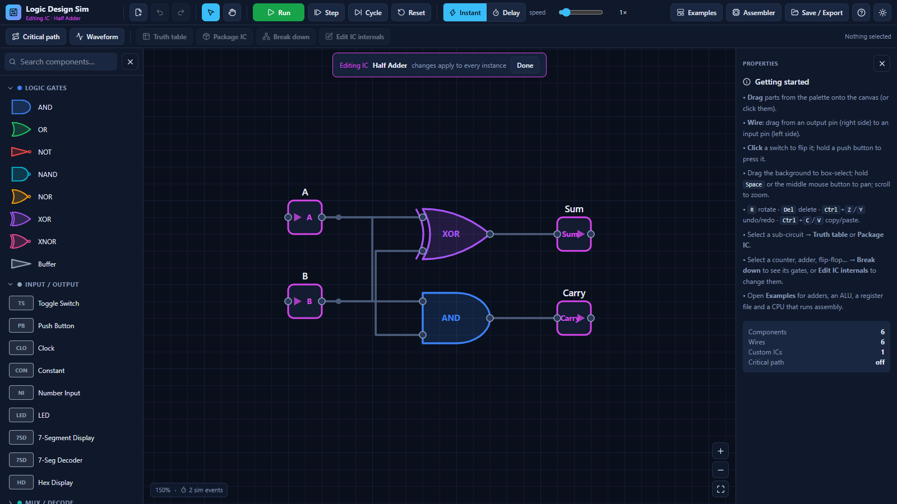

*Inside the Half Adder IC — the magenta blocks are the IC's input and output pins.*

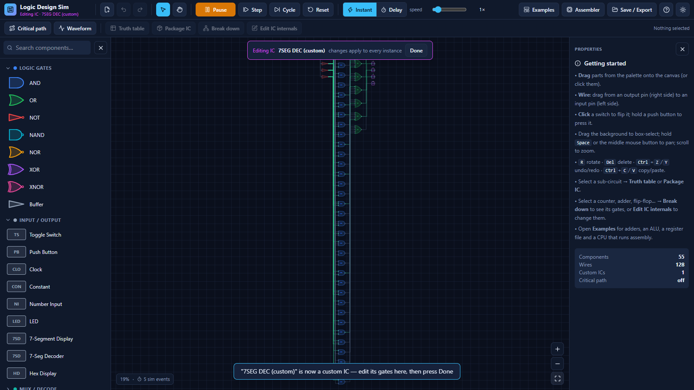

*The built-in 7-seg decoder opened with `Edit IC internals`: 55 gate-level components (AND product terms feeding wide ORs) inside an editable IC with the same pins, so the counter keeps driving it. `Break down` puts the same gates directly on the main canvas instead.*

### Examples

There are **12 preloaded examples** under `Examples`, building on each other: half adder → full adder → 4-bit adder → ALU → SR latch → ripple counter → BCD counter + 7-seg → **digital clock / stopwatch** → register file → **toy CPU datapath** — plus two self-hosting demos:

- **Self-Hosted Gate Simulator** — a netlist evaluator IC built from the palette: a counter walks a ROM "circuit file", two mirrored register files store the net values, an ALU applies each gate, one gate per tick.
- **Toy CPU: Gate Simulator in Assembly** — the same idea running as software on the CPU.

### Persistence

- Autosave to localStorage on every change (restored on reload, including an in-progress IC editing session).
- Named saves in the browser, JSON export/import, PNG and SVG export of the canvas.

## The toy CPU

The CPU example is a real 16-bit-instruction datapath: PC, program ROM, control ROM, 4-register file, ALU, data RAM with load/store, jump logic and an output register. The built-in program sums 5+4+3+2+1 and ends with `0F` on the output display.

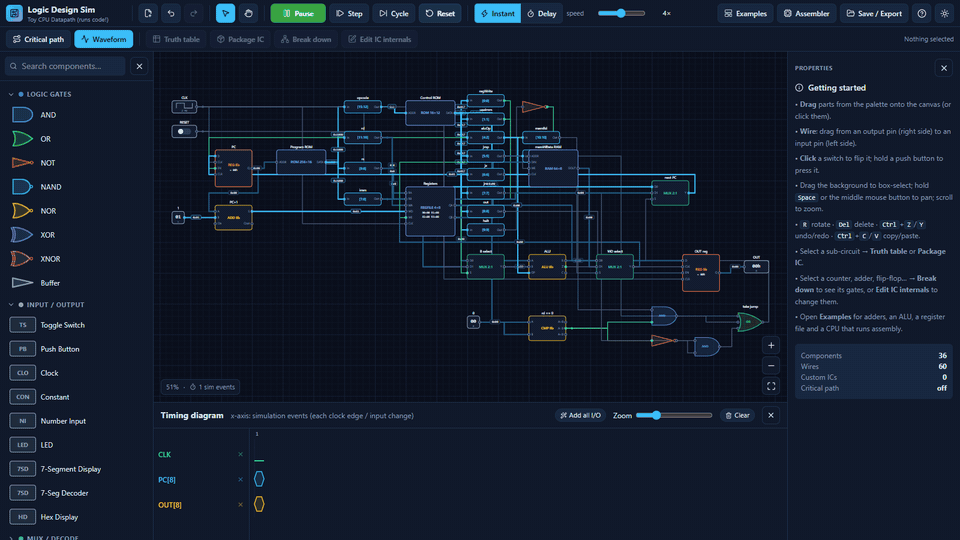

*The CPU datapath running the example program at 4× speed. The waveform viewer tracks CLK, PC and the OUT register as it climbs to `0Fh`, then the PC stops at HALT.*

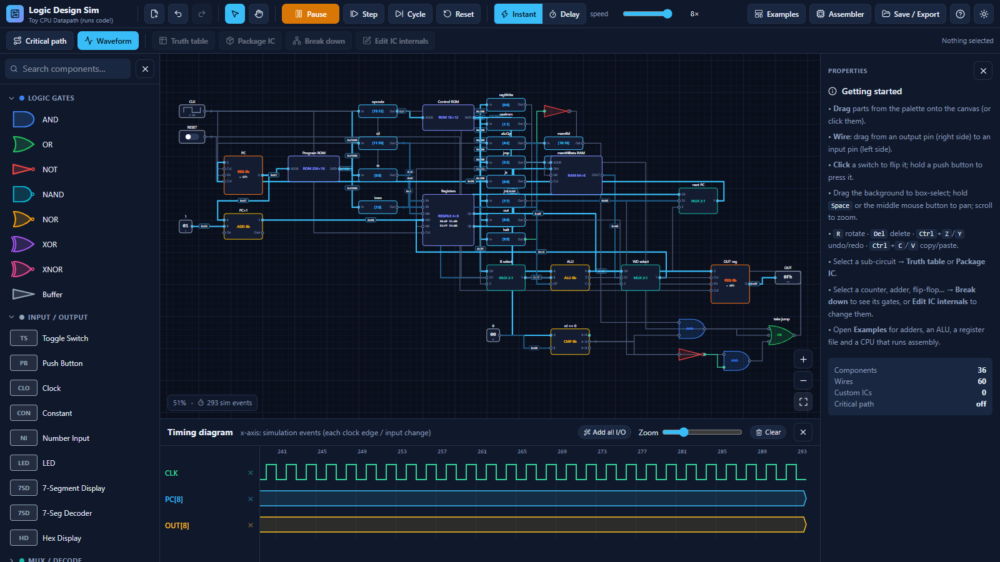

*Halted: the output register shows `0Fh` — the sum 5+4+3+2+1.*

Open the **Assembler** to edit the program: mnemonics on the left, the assembled machine-code listing on the right, one click to load it into the program ROM.

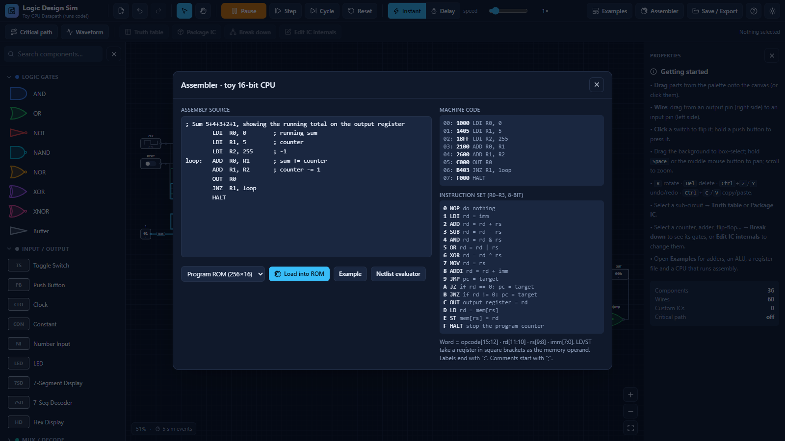

### Instruction set

Word format: `opcode[15:12] · rd[11:10] · rs[9:8] · imm[7:0]` — four registers R0–R3, 8-bit data.

| Opcode | Mnemonic | Semantics |
|---|---|---|
| 0 | `NOP` | do nothing |
| 1 | `LDI rd, imm` | rd = imm |
| 2 | `ADD rd, rs` | rd = rd + rs |
| 3 | `SUB rd, rs` | rd = rd − rs |
| 4 | `AND rd, rs` | rd = rd & rs |
| 5 | `OR rd, rs` | rd = rd \| rs |
| 6 | `XOR rd, rs` | rd = rd ^ rs |
| 7 | `MOV rd, rs` | rd = rs |
| 8 | `ADDI rd, imm` | rd = rd + imm |
| 9 | `JMP addr` | pc = addr |
| A | `JZ rd, addr` | if rd == 0: pc = addr |
| B | `JNZ rd, addr` | if rd != 0: pc = addr |
| C | `OUT rd` | output register = rd |
| D | `LD rd, [rs]` | rd = mem[rs] |
| E | `ST rd, [rs]` | mem[rs] = rd |
| F | `HALT` | stop the program counter |

Labels end with `:`; comments start with `;`. The memory operand of `LD`/`ST` must be a register in square brackets.

## Keyboard & mouse

| Input | Action |
|---|---|
| Drag from palette | add component (or click to drop in view center) |
| Drag from pin to pin | draw a wire (either direction; dropping on an occupied input replaces it) |
| Click switch / number input / clock | toggle / increment (Alt+click decrements) / flip phase |
| Hold push button | momentary 1 while held |
| Click component | select · Shift+click toggle in selection · drag moves the group |
| Drag background | box-select (wires between selected parts come along) |
| Double-click IC instance | edit that IC's definition (two quick taps on a touch screen) |
| Scroll / Ctrl+scroll | zoom (to cursor) / fine zoom · Shift+scroll horizontal pan |
| Space / middle mouse / Pan tool | pan |
| `R` | rotate 90° |
| `B` | break the selected IC / component down into its internals |
| `E` | edit the selected IC's internals (a built-in part becomes a custom IC first) |
| `Del` / `Backspace` | delete selection |
| Ctrl+Z / Ctrl+Y | undo / redo (100 steps) |
| Ctrl+C / X / V / D | copy / cut / paste / duplicate |
| Ctrl+A | select all (components and wires) |
| Arrow keys | nudge selection by one grid step (Shift = 5×) |
| Esc | close dialog / deselect |

## Phones & tablets

Below 1024 px wide the palette and properties panels become slide-over drawers (**Parts** / **Inspector** in the bottom bar), the toolbar shrinks to a single row with a **⋯** menu holding everything else, and a floating bar under the canvas offers rotate / duplicate / break down / edit internals / inspector / delete for the current selection.

| Gesture | Action |
|---|---|
| Tap | select · flip a switch · step a number input · toggle a clock |
| Drag a part | move it (the whole selection if it is part of one) |
| Drag from a pin to a pin | draw a wire |
| Drag the background | **Pan** mode: scroll the view · **Select** mode: draw a selection box |
| Pinch / two-finger drag | zoom / pan (works in either mode) |
| Double-tap an IC | open its internals |

On the desktop the toolbar is two fixed rows that never wrap or reshuffle: labels appear at fixed breakpoints, Run/Pause is a single fixed-width button, and the selection actions are always present (merely disabled).

## Component semantics worth knowing

- **Widths**: a component's bit width is a property (`w`). Connecting mismatched widths is not blocked; values are masked to each pin's width. Use splitter/merger to convert.
- **Decoder EN, register EN, counter UP default to 1** when unconnected, so minimal circuits work out of the box.
- **Encoder** assumes one-hot input (it ORs active indices); for multi-hot use the priority encoder.
- **Instant vs Delay**: instant mode settles the whole circuit after every change (relaxation solver, detects and flags oscillating feedback); delay mode steps a 1 ns tick grid so you can watch a carry ripple through the adder or an SR latch race.
- **Oscillation**: a ring oscillator flags "circuit does not settle" in instant mode; switch to delay mode to watch it actually oscillate.
- ICs nested more than 8 levels deep are not simulated (a warning toast appears).

## Project layout

```
src/
  lib/
    types.ts       data model (Circuit, Comp, Wire, ICDef, Probe)
    defs.ts        component registry: pins, eval functions, delays, palette
    engine.ts      simulation engine (netlist flattening, settling, ticks, STA, truth tables)
    boolean.ts     Quine–McCluskey minimization + gray-code K-maps for the truth-table view
    breakdown.ts   gate-level equivalents; Break down (inline an IC) and Edit IC internals (turn a part into a custom IC)
    ic.ts          package-selection → custom IC definition
    geometry.ts    layouts, pin positions, elbow wire routing
    templates.ts   the 12 example circuits, incl. the clock, the CPU datapath and two self-hosting demos
    assembler.ts   toy-CPU assembler
    store.ts       zustand state: history, selection, autosave, sim loop
    exporters.ts   JSON/PNG/SVG export, localStorage saves
    theme.ts       dark/light color tokens
  components/      React UI: Canvas (SVG, touch gestures), Palette, Properties, Toolbar, MobileBar, Waveform, Dialogs
  lib/__tests__/   vitest suite over the simulation core
docs/              screenshots and GIFs used by this README
```

## Testing

`npm test` runs 561 vitest tests covering:

- **Core logic**: gate truth tables, mux/decoder/priority-encoder semantics, an exhaustive 4-bit adder, ALU operations, latch/flip-flop edge behavior, counters (binary + BCD), shift register, RAM/ROM/register file.
- **Timing**: clock timing, transport-delay semantics, oscillation detection, critical-path analysis.
- **Hierarchy & analysis**: IC packaging with 3-level nesting, truth-table generation.
- **CPU & examples**: the assembler (including LD/ST) and every example template — the CPU's example program halting with 15 in the output register, the Self-Hosted Gate Simulator evaluating its full-adder netlist in both instant and delay mode, the CPU's assembly netlist evaluator settling the same full adder in Data RAM, and the digital clock counting through 59:59 → 00:00 (also with RUN / RESET, and after every digit IC has been broken down into gates).
- **Break down / Edit IC internals**: each gate-level expansion is proven equivalent to its built-in component *three ways at once* — the original part, the part converted into a custom IC and the part broken down inline — with exhaustive sweeps for small widths, directed + sampled sweeps for wide ones, scripted clocked sequences for sequential parts (BCD wraps, async clears, the SR latch's forbidden state), pin-default propagation across the IC boundary, delay-mode flip-flop timing, and structural tests for inlining (pass-through pins, outputs fed back into their own IC, dangling outputs, probes, placement without overlap, unused auto-generated defs).
- **Store**: undo across editing sessions, nested IC editors, autosave of an in-progress nested session, loading a circuit while an editor is open, and the refusal to place an IC inside itself.

## License

MIT — see [LICENSE](LICENSE).
